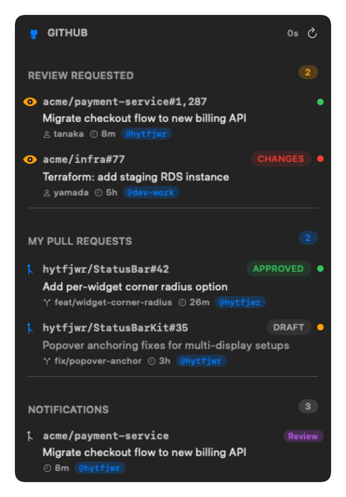

# GitHub Plugin for StatusBar

GitHub pull requests and notifications in your [StatusBar](https://github.com/hytfjwr/StatusBar), powered by the `gh` CLI.

<p align="center">
  
</p>

## Features

- **Bar indicator** — shows pending review count and your open PR count at a glance
- **Review Requested** — PRs where your review (or your team's) is requested, across every repo
- **My Pull Requests** — your open PRs with Draft status, review decision (Approved / Changes Requested / Review Required), and CI status
- **Notifications** — unread GitHub notifications with type icons and reason labels
- **Multi-account** — uses every account signed in to `gh auth status`, or an explicit list
- **Toast alerts** — new review requests, PR approvals, and change requests notify via StatusBar toasts (with an "Open" action)
- **Click any row** to open it in the browser

## Install

In StatusBar preferences → Plugins → Add Plugin:

```
hytfjwr/statusbar-plugin-github
```

## Requirements

- macOS 26+
- [GitHub CLI](https://cli.github.com/) (`gh`) signed in — `gh auth login`
- For the Notifications section: `gh auth refresh -s notifications` (per account)
- StatusBar 0.20.0+ / StatusBarKit 1.10.1+

## Data Sources

| Section | Source |
|---------|--------|
| My PRs | GraphQL search `is:pr is:open author:<login>` |
| Review Requested | GraphQL search `is:pr is:open (review-requested:<login> OR team-review-requested:<login>)` |
| Notifications | `GET /notifications` (unread) |

Each account is queried with its own token (`gh auth token -u <login>`), so non-active `gh` accounts work too.

## Settings

| Key | Default | Description |
|-----|---------|-------------|
| `accounts` | *(auto)* | Comma-separated gh logins; empty = all authenticated accounts |
| `refreshInterval` | `60` | Notification poll interval in seconds (min 15; GitHub caps freshness at ~60s) |
| `prRefreshInterval` | `120` | PR (GraphQL) fetch interval in seconds (min 60); also refetches on review-relevant notifications |
| `showNotifications` | `true` | Show the notifications section |
| `showBarCounts` | `true` | Show PR counts next to the bar icon |
| `toastOnReviewRequest` | `true` | Toast when a new review request arrives |
| `toastOnReviewDecision` | `true` | Toast when your PR is approved / gets changes requested |
| `sectionOrder` | `review,mine,notifications` | Popup section order — comma-separated subset/reordering of `review`, `mine`, `notifications` |

## Development

```bash
make dev    # Build + install to ~/.config/statusbar/plugins/
swift test  # Run tests
```

Then restart StatusBar (or reload plugins) to pick up the new bundle.

## Releasing

Releases are automated via GitHub Actions: **Actions → Release → Run workflow** and pick a bump type.
